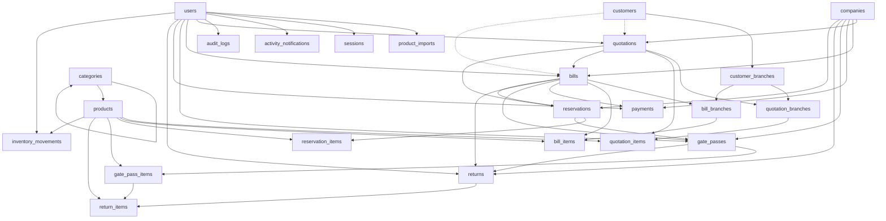
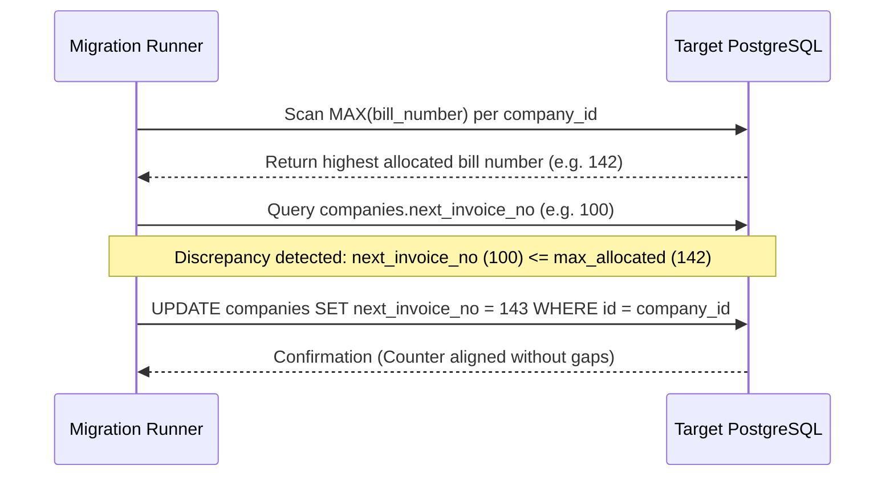
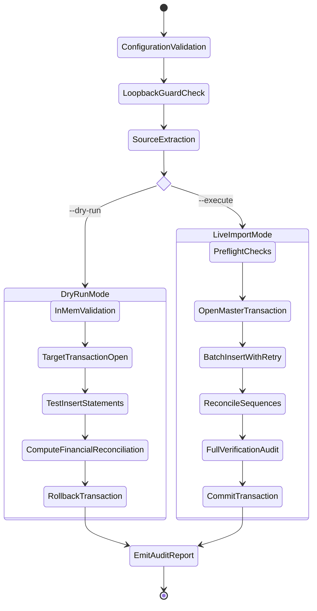
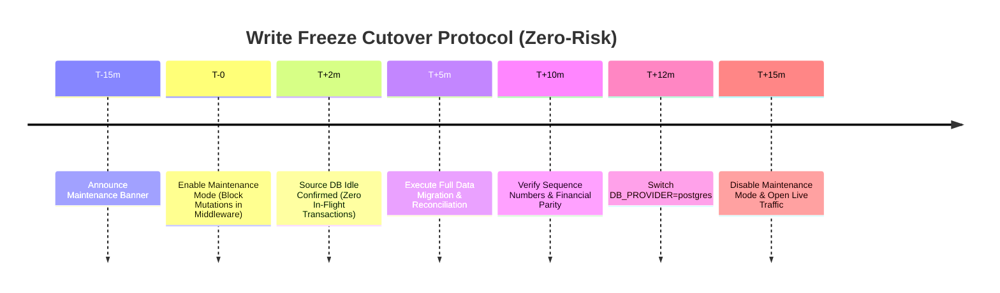

# Standalone PostgreSQL Data Migration Specification & Tool Design

**Project:** Tamilnadu Suppliers Rental ERP  
**Target Environment:** Standalone PostgreSQL 16+ on Coolify Private Network  
**Source Backend:** Supabase Cloud (PostgreSQL 15 / PostgREST)  
**Document Status:** Architecture & Design Specification (Batch 6.2B)  
**Safety Scope:** Review and Design Only — No Execution Against Live Databases  

---

## 1. Executive Summary & Architectural Objectives

This document establishes the authoritative data migration design to transfer all data from the dedicated Supabase Cloud instance (`lznyejowgqwbavtnqqns`) to the standalone PostgreSQL cluster.

### Key Design Tenets
1. **Zero Data Loss & Financial Parity:** Exact decimal-safe reconciliation of financial totals, line items, and stock balances.
2. **Strict Foreign Key Integrity:** Complete topological import order across all 26 schema tables, preventing constraint violations.
3. **Idempotence & Determinism:** Ability to run dry-run simulations and perform multi-phase transactional imports with deterministic retries and clean rollback.
4. **Change Capture & Consistency:** Comprehensive accounting for in-flight updates, deletions, and inserts using a controlled write-freeze cutover strategy.
5. **Security & PII Redaction:** Automatic redaction of credentials, session tokens, passwords, customer phone numbers, and financial details from all logs and failure reports.

---

## 2. Complete Table Inventory & Topological Dependency Order

The standalone schema comprises **26 tables** initialized in `supabase/standalone-postgres-init.sql`. Tables must be extracted and inserted strictly in topological dependency order to satisfy all active foreign key constraints.



### Complete Ordered Table Specification

| Import Order | Table Name | Foreign Key Dependencies | Self-References / Cycle Handling | Primary Key Type |
| :---: | :--- | :--- | :--- | :--- |
| **1** | `companies` | None | None | `VARCHAR(100)` |
| **2** | `users` | None | None | `VARCHAR(100)` |
| **3** | `customers` | None | None | `VARCHAR(100)` |
| **4** | `login_rate_limits` | None | None | `VARCHAR(255)` (key) |
| **5** | `categories` | `categories.parent_id` (Self) | Import with `parent_id = NULL`, update in second pass | `VARCHAR(100)` |
| **6** | `products` | `categories.id` | None | `VARCHAR(100)` |
| **7** | `customer_branches` | `customers.id` | None | `UUID` |
| **8** | `product_imports` | `users.id` | None | `UUID` |
| **9** | `sessions` | `users.id` | None | `UUID` |
| **10** | `activity_notifications` | `users.id` | None | `UUID` |
| **11** | `audit_logs` | `users.id` (`actor_id`) | None | `UUID` |
| **12** | `whatsapp_logs` | `users.id` | None | `UUID` |
| **13** | `quotations` | `companies.id`, `users.id` | Reference to `converted_bill_id` (unconstrained in DDL) | `VARCHAR(100)` |
| **14** | `quotation_branches` | `quotations.id`, `customer_branches.id` | None | `UUID` |
| **15** | `quotation_items` | `quotations.id`, `quotation_branches.id` | Note lines have `product_id = NULL` | `UUID` |
| **16** | `bills` | `companies.id`, `quotations.id`, `users.id` | None | `VARCHAR(100)` |
| **17** | `bill_branches` | `bills.id`, `customer_branches.id` | None | `UUID` |
| **18** | `bill_items` | `bills.id`, `bill_branches.id` | Note lines have `product_id = NULL` | `UUID` |
| **19** | `payments` | `companies.id`, `bills.id`, `users.id` | None | `VARCHAR(100)` |
| **20** | `reservations` | `companies.id`, `quotations.id`, `bills.id`, `users.id` | None | `VARCHAR(100)` |
| **21** | `reservation_items` | `reservations.id`, `products.id` | None | `VARCHAR(100)` |
| **22** | `gate_passes` | `companies.id`, `bills.id`, `reservations.id`, `users.id` | None | `VARCHAR(100)` |
| **23** | `gate_pass_items` | `gate_passes.id`, `products.id` | None | `VARCHAR(100)` |
| **24** | `returns` | `companies.id`, `gate_passes.id`, `users.id` | None | `VARCHAR(100)` |
| **25** | `return_items` | `returns.id`, `products.id`, `gate_pass_items.id` | None | `VARCHAR(100)` |
| **26** | `inventory_movements`| `products.id`, `users.id` | None | `UUID` |

---

## 3. Data Extraction Architecture (Handling PostgREST Limits)

Supabase Cloud exposes PostgreSQL through PostgREST, which enforces a server-side maximum limit (typically 1,000 rows per request) to prevent memory exhaustion.

### Dual Extraction Protocol

The migration tool must support two extraction protocols:

```mermaid
flowchart LR
    subgraph Direct Extraction (Preferred)
        S1[Supabase Direct pg Pool] -->|Streaming Cursor / Batch Limit| E1[Memory Stream]
    end
    subgraph PostgREST Fallback
        S2[Supabase JS Client] -->|ID-Sorted Keyset Range| E2[Memory Stream]
    end
    E1 --> T[Type Sanitizer & Validator]
    E2 --> T
    T --> P[Pipeline Transformer]
```

#### 1. Protocol A: Direct PostgreSQL Streaming (Preferred)
- Connects directly to the Supabase Cloud direct PostgreSQL pooler (`db.lznyejowgqwbavtnqqns.supabase.co:5432`) using `DATABASE_URL` with read-only transaction isolation (`SET TRANSACTION READ ONLY ISOLATION LEVEL REPEATABLE READ`).
- Uses `pg-query-stream` with a chunk size of 2,500 records.
- Guarantees transactional consistency across all tables at snapshot timestamp $T_0$.

#### 2. Protocol B: PostgREST Keyset Pagination (Fallback)
If direct TCP port 5432 is restricted by network firewalls, the extractor falls back to HTTPS API extraction:
- Strictly avoids offset-based pagination (`.range(10000, 11000)`), which suffers from $O(N)$ query degradation and missed rows under concurrent shifts.
- Implements **deterministic keyset pagination** based on primary key:
  ```typescript
  let hasMore = true;
  let lastId: string | null = null;
  const CHUNK_SIZE = 1000;

  while (hasMore) {
    let query = supabase
      .from(tableName)
      .select("*")
      .order("id", { ascending: true })
      .limit(CHUNK_SIZE);

    if (lastId) {
      query = query.gt("id", lastId);
    }

    const { data, error } = await query;
    if (error) throw new Error(`[EXTRACTION ERROR] ${tableName}: ${error.message}`);
    if (!data || data.length === 0) {
      hasMore = false;
      break;
    }

    yield data;
    lastId = data[data.length - 1].id;
    if (data.length < CHUNK_SIZE) hasMore = false;
  }
  ```
- Exponential backoff with jitter on HTTP 429 (Rate Limit) or 5xx server errors (initial delay 500ms, max 5 retries).

---

## 4. Comprehensive Type Mapping & Value Normalization

| Source Data Domain | Supabase / JS Inbound Type | Target Standalone Type | Normalization Rule | Edge Cases Handled |
| :--- | :--- | :--- | :--- | :--- |
| **Primary & Foreign Keys** | `string` (UUID or prefixed slug) | `VARCHAR(100)` or `UUID` | Trim whitespace; preserve original value; empty string `""` converts to `NULL`. | Resolves UUID vs `VARCHAR(100)` mismatch across migration history. |
| **Timestamps** | ISO-8601 string / Unix epoch / `null` | `TIMESTAMPTZ` | Parse with `new Date(val)`. Verify valid date; format to `toISOString()`. | Invalid dates or `'0000-00-00'` rejected; missing `created_at` defaults to `NOW()`. |
| **Financial Money Amounts** | `number` (IEEE 754 float) / `string` | `NUMERIC(12,2)` / `NUMERIC(15,2)` | Convert through string representation: `Number(val).toFixed(2)` or Decimal object. Never perform floating-point accumulation. | Prevents precision drift (e.g. `19.999999999999996` clamped to exact decimal). |
| **JSON & JSONB Documents** | `object` / `array` / `string` | `JSONB` | If object/array: `JSON.stringify(val)`. If string: validate `JSON.parse(val)` before insertion. | Corrupted JSON strings caught before DB insertion; `null` mapped to `[]` or `{}` per schema defaults. |
| **Nullable String Columns** | `null` / `""` / `"   "` | `TEXT` / `VARCHAR(N)` | Trim strings; if trimmed length is 0 and column is nullable, coerce to `NULL`. | Prevents blank strings from violating unique constraints (e.g. `users.username`). |
| **Booleans** | `boolean` / `0` / `1` / `"true"` | `BOOLEAN` | Strict coercion: `val === true || val === 'true' || val === 1`. | Unset optional boolean defaults to schema-defined default. |
| **Enumerations / Check Constraints** | `string` | `VARCHAR(N)` + `CHECK` | Convert to uppercase; validate against whitelist (e.g., `role IN ('SUPER_ADMIN', 'ADMIN', 'BILLING', 'EMPLOYEE')`). | Rejects unknown roles or legacy statuses before DB rejects the transaction. |

---

## 5. Sequence, Document Numbering, and Identity State Reconciliation

Unlike systems relying solely on PostgreSQL `BIGSERIAL` sequences, the Tamilnadu Suppliers Rental ERP manages invoice, quotation, and gate pass numbering through dedicated sequence counters stored in `public.companies`:
- `companies.next_invoice_no` (allocates `TNS-0001`, `TNS-0002`, etc.)
- `companies.next_quotation_no` (allocates `TNQ-0001`, etc.)
- `companies.next_gate_pass_no` (allocates `TNGP-0001`, etc.)

### Sequence Counter Synchronization Protocol

During migration, if company records were created prior to the latest bills, their `next_*_no` counters may lag behind the actual max document numbers allocated in the database.



#### SQL Counter Reconciliation Routine
Immediately following table imports, execute:
```sql
-- 1. Synchronize Bill Invoices
UPDATE public.companies c
SET next_invoice_no = GREATEST(
    c.next_invoice_no,
    COALESCE((
        SELECT MAX(
            NULLIF(regexp_replace(b.bill_number, '^[^0-9]+', '', 'g'), '')::INTEGER
        ) + 1
        FROM public.bills b
        WHERE b.company_id = c.id
    ), c.next_invoice_no)
);

-- 2. Synchronize Quotations
UPDATE public.companies c
SET next_quotation_no = GREATEST(
    c.next_quotation_no,
    COALESCE((
        SELECT MAX(
            NULLIF(regexp_replace(q.quotation_number, '^[^0-9]+', '', 'g'), '')::INTEGER
        ) + 1
        FROM public.quotations q
        WHERE q.company_id = c.id
    ), c.next_quotation_no)
);

-- 3. Synchronize Gate Passes
UPDATE public.companies c
SET next_gate_pass_no = GREATEST(
    c.next_gate_pass_no,
    COALESCE((
        SELECT MAX(
            NULLIF(regexp_replace(gp.gate_pass_number, '^[^0-9]+', '', 'g'), '')::INTEGER
        ) + 1
        FROM public.gate_passes gp
        WHERE gp.company_id = c.id
    ), c.next_gate_pass_no)
);
```

---

## 6. Execution Modes: Dry-Run vs. Import



### Dry-Run Mode (`--dry-run`)
1. **Zero-Mutation Guarantee:** Runs within an explicit PostgreSQL transaction that terminates with an unconditional `ROLLBACK`.
2. **Schema & Constraint Validation:** Inserts actual transformed batches to ensure PostgreSQL checks, foreign keys, triggers, and unique constraints pass on the target schema.
3. **In-Memory Integrity Audit:** Validates all parent-child links, note line formats, and JSON structures before attempting target queries.
4. **Output:** Comprehensive reconciliation report detailing expected row counts, schema warnings, and financial sums without writing a single permanent row.

### Import Mode (`--execute`)
1. **Pre-Flight Safety Verification:**
   - Validates that `DB_PROVIDER=postgres` target is online and matches loopback/private Coolify network.
   - Enforces target database safety check (must not be production unless `--confirm-production-cutover` is explicitly passed).
2. **Deterministic Transactional Batching:**
   - Processes tables in topological order.
   - For each table, inserts records in chunks of 500 rows using parameterized multi-row `INSERT ... ON CONFLICT (id) DO UPDATE`.
   - Uses PostgreSQL transaction `SAVEPOINT`s per table. If a batch fails, retries up to 3 times before rolling back to savepoint and halting.
3. **Atomic Cutover:** The entire migration runs inside a master transaction or sequential savepoint sequence that commits only after post-import reconciliation succeeds 100%.

---

## 7. Comprehensive Reconciliation Specification

### A. Row-Count & Per-Table Reconciliation
For every table $T \in \{1 \dots 26\}$:
$$\Delta_{\text{count}}(T) = \text{Count}_{\text{source}}(T) - \text{Count}_{\text{target}}(T)$$
- Migration is accepted if and only if $\forall T, \Delta_{\text{count}}(T) = 0$.

### B. Decimal-Safe Financial Reconciliation
Financial values must be aggregated using exact two-decimal precision. Accumulators in the migration tool must use either string-based integer cents or `BigInt`:

$$\text{Cents}(v) = \text{Math.round}(\text{Number}(v) \times 100)$$

The reconciliation checks:
1. **Bill Totals Parity:**
   $$\sum \text{bills.grand\_total} \stackrel{?}{=} \sum \text{bills.subtotal} + \sum \text{bills.tax\_amount} - \sum \text{bills.discount\_amount}$$
2. **Payment Allocation Balance:**
   $$\forall \text{bill}_i : \text{bill}_i\text{.balance\_amount} \stackrel{?}{=} \text{bill}_i\text{.grand\_total} - \sum \text{payments.amount}(\text{bill}_i)$$
3. **Discrepancy Threshold:** **0.00 INR**. Any discrepancy $\ge 0.01$ INR immediately aborts the cutover.

### C. Cross-Table Structural Integrity Rules
1. **Quotation Conversion Integrity:** For every bill with `source_quotation_id IS NOT NULL`, the referenced quotation must exist and have `status = 'CONVERTED'`.
2. **Line Item Association:**
   - Every `bill_item` must reference a valid `bill_id`.
   - For items with `entry_type = 'item'`, `product_id` must reference a valid product in `public.products`.
   - For items with `entry_type = 'note'`, `product_id` must be `NULL` and `quantity` must be 0.
3. **Gate Pass & Return Reconciliation:**
   - For every `gate_pass_item`, `quantity` must be $> 0$.
   - For every `return_item`, `gate_pass_item_id` must reference an item belonging to the associated bill's gate pass.
   - Cumulative returned quantity across all return batches must not exceed total dispatched quantity:
     $$\sum \text{return\_items.quantity}(\text{item}_k) \le \text{gate\_pass\_items.quantity}(\text{item}_k)$$
4. **Audit Trail Completeness:**
   - Every `audit_logs` record must have a valid `action`, `entity_type`, and timestamp.
   - `actor_id` must either be `NULL` (system) or match a valid `users.id`.

---

## 8. Source Change-Capture Strategy & Write Freeze

### The "Created At Alone Is Insufficient" Principle
A common flaw in database migrations is capturing changes via `created_at > T_0`. This fails catastrophically for rental ERPs because:
1. **Updates to Pre-Existing Records:** A user records a payment on an existing bill; `bills.balance_amount` updates, but `bills.created_at` remains unchanged.
2. **Status Transitions:** In-flight returns change bill operational status from `OUT_ON_RENT` to `RETURN_INSPECTION` or `PENDING_SETTLEMENT`.
3. **Deletions / Cancellations:** An un-dispatched quotation or draft bill is deleted. Incremental `created_at` queries will never detect deleted rows.

### The Two Migration Strategies



#### Strategy 1: Controlled Write Freeze (Recommended Enterprise Standard)
- **Mechanism:** Prior to cutover, set `NEXT_PUBLIC_MAINTENANCE_MODE=true` in the application server. The application middleware intercepts all POST/PUT/PATCH/DELETE routes and returns HTTP 503 (`System undergoing planned database maintenance. Read access only`).
- **Advantage:** Guarantees zero concurrent mutations, zero phantom updates, and zero deleted rows during migration. Total execution time for this database volume is under 3 minutes.
- **Verification of Idle Source:** Query `pg_stat_activity` on Supabase to confirm zero active write queries before extraction begins.

#### Strategy 2: Dual-Pass Changelog Sync (If Write Window Is Prohibited)
If a strict zero-downtime cutover is mandated:
1. **Pass 1 (Initial Bulk):** Extract all tables at $T_0$.
2. **Pass 2 (Delta Sync):**
   - Query tables where `updated_at >= T_0`.
   - For tables without `updated_at`, cross-reference `audit_logs` where `created_at >= T_0` to identify modified `entity_id` records.
   - Re-extract and `UPSERT` those specific entity clusters.
   - Brief write freeze (30 seconds) only during final sequence reconciliation and DNS switch.

*Recommendation:* **Strategy 1 (Controlled Write Freeze)** is recommended for Batch 6.3 execution due to the strict financial integrity requirements of rental accounting.

---

## 9. Security, Redaction & Failure Reporting

### Data Privacy & Log Redaction Filters
The migration tool must sanitize all console output, logs, and failure artifacts.

```typescript
const SENSITIVE_PATTERNS = [
  /password/i,
  /secret/i,
  /token/i,
  /gstin/i,
  /phone/i,
  /email/i,
  /pan/i,
  /bank_account/i,
];

export function sanitizeLogValue(key: string, value: any): any {
  if (value === null || value === undefined) return value;
  if (SENSITIVE_PATTERNS.some(p => p.test(key))) {
    return "[REDACTED]";
  }
  return value;
}
```

### Structured Failure Reporting
If a failure occurs during extraction, validation, or insertion, the tool writes an audit artifact to `docs/postgres-migration/reports/migration-failure-<timestamp>.json` with the following structure:

```json
{
  "timestamp": "2026-10-27T10:00:00.000Z",
  "status": "FAILED",
  "stage": "INSERT_BATCH",
  "failedTable": "bill_items",
  "batchIndex": 4,
  "errorCode": "23503",
  "constraintName": "bill_items_bill_id_fkey",
  "failureSummary": "Foreign key violation: bill_id references non-existent parent bill",
  "affectedRecordIdentifiers": [
    "item-uuid-1",
    "item-uuid-2"
  ],
  "sanitizedPayloadSample": {
    "id": "item-uuid-1",
    "bill_id": "non-existent-bill-id",
    "entry_type": "item",
    "quantity": 10,
    "unit_price": "[REDACTED]",
    "total_amount": "[REDACTED]"
  },
  "remediationGuidance": "Verify parent bill was not deleted or excluded by pagination limit."
}
```

---

## 10. Unresolved Architectural Questions for User Review

Before proceeding to Batch 6.3 (Tool Implementation), the following operational questions should be confirmed:

1. **Cutover Window Selection:** Is a 15-minute scheduled maintenance window (Strategy 1) acceptable for production cutover, or is zero-downtime dual-pass sync (Strategy 2) required?
2. **Historical Session Migration:** Should active user web sessions in `public.sessions` be migrated, or should all users be required to re-authenticate against the new standalone PostgreSQL instance upon cutover? *(Recommendation: Invalidate sessions during cutover to guarantee clean session secret alignment).*
3. **Rate-Limit State Migration:** Should transient counters in `public.login_rate_limits` be migrated, or initialized clean? *(Recommendation: Initialize clean, as rate-limit windows expire within 15 minutes).*
